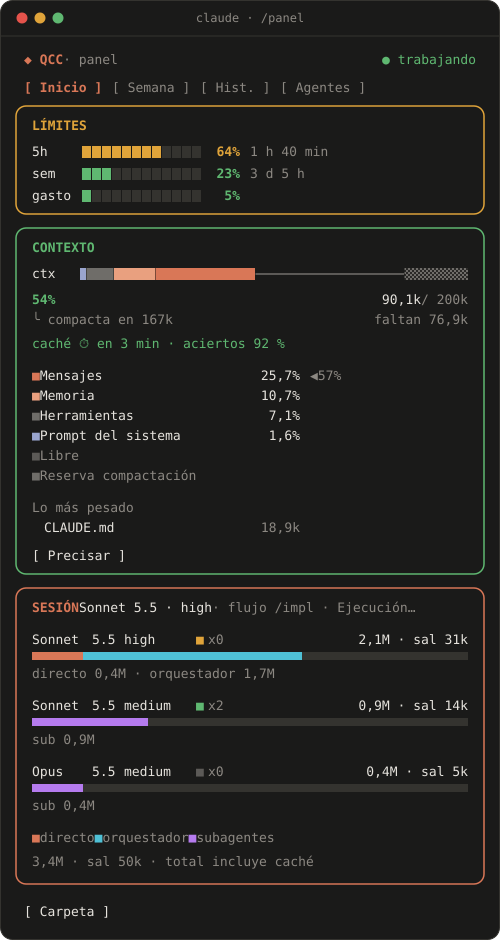
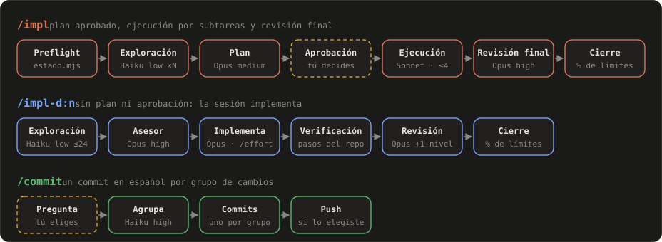
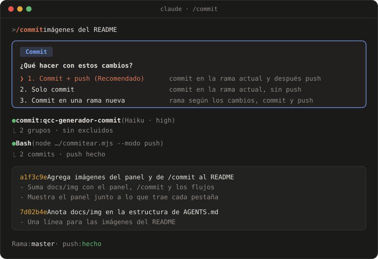

<div align="center">

# ◆ QCC

**Q**uorum **C**laude **C**ode · flujos multi-agente y panel de uso para Claude Code

Un cambio no se da por hecho hasta que varios agentes lo aprueban: el quórum.


[Plugins](#plugins) · [Panel](#panel) · [Flujos](#flujos) · [/commit](#commit) · [Instalar](#instalar) · [Verificar](#verificar)

</div>

---

## Plugins

Son herramientas personales, en cuatro plugins del marketplace `qcc` (`.claude-plugin/marketplace.json`). Las carpetas conservan el nombre largo.

| Plugin | Carpeta | Qué es | Documentación |
|---|---|---|---|
| 📊 `panel` | `qcc-panel/` | Panel lateral con los límites de uso, el contexto, el consumo por modelo·esfuerzo, el historial de flujos y los subagentes. | [MODS.md](MODS.md) |
| 🧭 `impl` | `qcc-implementador/` | `/impl`: explora, planifica, pide aprobación, ejecuta por subtareas y cierra con una revisión final independiente. | [FLUJOS.md](FLUJOS.md) |
| ⚡ `impl-d` | `qcc-impl-directo/` | `/impl-d:n` y `:p`: sin plan ni aprobación; la sesión implementa, verifica y cierra con una revisión independiente. | [FLUJOS.md](FLUJOS.md#impl-d) |
| 📝 `commit` | `qcc-commit/` | `/commit`: un commit en español por grupo de cambios, con push opcional, todo en Haiku high. | [FLUJOS.md](FLUJOS.md#commit) |

## Panel



`/panel` lo abre al costado de la conversación; `/panel carpeta` abre la carpeta del proyecto. Cuesta 0 tokens: solo mira los eventos que ya pasan por Claude Code.

- **Límites:** 5 horas, semanal y de gasto, con su barra, el % y cuánto falta para que se reinicien. Salen en todas las pestañas.
- **Contexto** (`i`): lo usado, dónde compacta y cuánto falta, el desglose por partes como `/context`, lo más pesado y la cuenta regresiva del caché del prompt con su % de aciertos. **Precisar** (`p`) cambia la estimación por un conteo exacto.
- **Sesión:** modelo, esfuerzo y paso del flujo en curso; tokens por modelo·esfuerzo con el tramo directo, el del orquestador y el de los subagentes. El ■ de cada fila dice si trabaja (verde), espera una herramienta (amarillo) o reposa (gris), y `xN` cuántos subagentes corren con ese modelo.
- **Semana** (`s`): el gasto de la ventana semanal por modelo y por día.
- **Hist.** (`h`): los últimos 10 flujos de `/impl`, con tiempo, tokens, % de la ventana de 5 h, líneas cambiadas y subtareas.
- **Agentes** (`a`): los subagentes de la sesión, su estado y su gasto, y los archivos que se editaron.
- **Avisos y freno:** avisa cuando el plan espera tu aprobación, cuando un flujo termina y cuando el contexto pasa del 80 % y del 95 %. Con más de 60k de contexto frena una vez un `/impl` sin `/clear` antes.

Todo el detalle está en [MODS.md](MODS.md).

<br clear="right">

## Flujos



Los flujos son skills de Claude Code: solo corren cuando el usuario escribe el comando, nunca por iniciativa del modelo.

| Comando | Para qué |
|---|---|
| `/impl <qué cambiar>` | Cambios con exploración, plan aprobado por el usuario, ejecución por subtareas, verificación real y revisión final independiente. Un flujo cortado (límite de uso, sesión cerrada, otra cuenta) se sigue con `/impl reanudar` sin perder lo hecho: el cierre suma todas sus sesiones en una sola fila del historial. Con `/impl -p` no pregunta nada (sirve con `claude -p`): ver [FLUJOS.md](FLUJOS.md#comandos). |
| `/impl-d:n <qué cambiar>` | Cambios sin plan ni aprobación: exploración con Haiku, un asesor Opus que revisa el enfoque antes de editar, la sesión implementa en Opus con el esfuerzo de `/effort`, verificación y revisión independiente en Opus un nivel arriba (high desde medium, xhigh desde high o xhigh). El cierre dice el % de la ventana de 5 h y de la semanal que gastó, como `/impl`. Acepta `-p`, igual que `/impl`. Sin carpeta de flujo ni pasos en el panel; cada corrida queda en `registros/impl-d.jsonl`. |
| `/impl-d:p <qué cambiar>` | Igual que `/impl-d:n`, pero la sesión no edita: orquesta y deriva la implementación y cada corrección a trabajadores Opus (varios a la vez si hay partes sin archivos en común), y verifica y revisa. Su contexto queda chico en tareas largas. |
| `/commit [por qué]` | Separa los cambios sin commit en grupos lógicos y hace un commit en español por grupo. Es el único camino para hacer commits: ningún flujo ni agente los hace por su cuenta. |

> [!TIP]
> Para cambios de documentación o pequeños conviene trabajar directo en vez de usar un flujo completo.

## /commit



```
/commit
/commit arregla el freno de contexto del panel
```

El texto opcional es el porqué del cambio: el agente lo usa para escribir los mensajes.

1. **Pregunta** qué hacer: commit + push (recomendado), solo commit o commit en una rama nueva. Sin poder preguntar (`claude -p`), hace solo commit.
2. **Agrupa:** el agente `qcc-generador-commit` (Haiku high) lee todo lo que no tiene commit, esté o no en stage, y lo separa en grupos lógicos: el código con sus tests y su documentación. Su guardia `solo-git` le deja correr solo `git status`, `diff`, `log` y `show`.
3. **Hace un commit por grupo**, con el mensaje en español, sin `--amend`, `--no-verify` ni atribuciones a Claude: el autor es tu cuenta de git.
4. **Sube** con `git push -u origin HEAD`, salvo con «Solo commit». Nunca `--force`.

Los archivos con aspecto de secreto (`.env*`, `.pem`, `.key`, `id_rsa*`…) nunca entran en un commit: el cierre los nombra como excluidos. Detalles en [FLUJOS.md](FLUJOS.md#commit).

## Instalar

Desde la raíz del repo:

```
claude plugin marketplace add <ruta del repo>
claude plugin install panel@qcc
claude plugin install impl@qcc
claude plugin install impl-d@qcc
claude plugin install commit@qcc
```

Los plugins se leen desde el repo: después de editar uno, `/reload-plugins` lo vuelve a leer. Detalles del panel en [MODS.md](MODS.md#instalación) y de los flujos en [FLUJOS.md](FLUJOS.md#instalación).

Si quedan en `~/.claude` las copias de `/impl` y `/commit` de una instalación por copia, `node qcc-implementador/instalar.mjs` las lista y `--limpiar` las archiva en `~/.claude/_archivo-limpieza-<fecha>/`.

## Verificar

```
claude plugin validate qcc-panel
claude plugin test qcc-panel
node --test "qcc-implementador/herramientas/*.test.mjs"
node --test qcc-commit/herramientas/solo-git.test.mjs
node --test "qcc-impl-directo/herramientas/*.test.mjs"
```

Los cinco comandos tienen que terminar sin errores antes de dar algo por hecho (ver [AGENTS.md](AGENTS.md#verificar)).

## Documentación

| Archivo | Qué cubre |
|---|---|
| [AGENTS.md](AGENTS.md) | Reglas generales del repo para Claude: estructura, verificación y convenciones. |
| [MODS.md](MODS.md) | El panel de uso. |
| [FLUJOS.md](FLUJOS.md) | Los flujos: `/impl`, `/impl-d` y `/commit`. |
| [LIMITES.md](LIMITES.md) | Qué miden los límites de 5 h y semanal, y cómo `/impl` anota el % que gasta cada corrida y cada fase. |

Las imágenes de `docs/img/` son ilustraciones en SVG dibujadas a partir de lo que muestra cada plugin.

## Licencia

[MIT](LICENSE).
